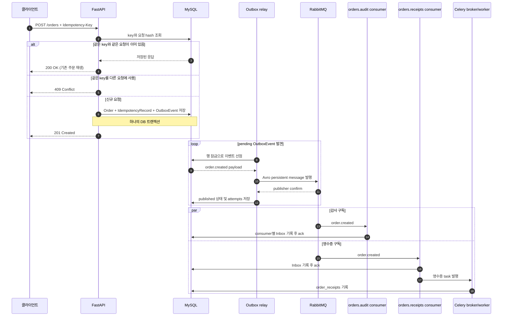

# Order Flow 학습 노트

이 문서는 `apps/order-flow`의 코드를 읽고 실행하면서 메시지 처리의 경계와 보장을 복습하기 위한 워크북이다. 코드를 실행하는 것만으로 학습 체크를 완료하지 않는다. 각 항목을 직접 확인하거나 자기 말로 설명한 뒤 체크한다.

## 학습 경로

- [ ] 현재 흐름을 아래 그림 없이 말로 설명한다.
- [ ] 주문 요청의 멱등성 재시도와 충돌을 직접 확인한다.
- [ ] MySQL에서 주문부터 영수증까지 한 건을 연결해 본다.
- [ ] Outbox relay의 중복 발행 가능성과 consumer Inbox의 역할을 설명한다.
- [ ] Inbox commit과 Celery 제출 사이의 유실 가능성을 설명한다.
- [ ] 뒤 단계의 Task Outbox를 적용한 뒤 현재와 보장 차이를 비교한다.

## 1. 한 건의 주문이 지나가는 길



API 응답은 주문이 DB에 접수됐다는 뜻이다. 응답 시점에 RabbitMQ 발행이나 영수증 처리가 끝났다는 뜻은 아니다. 후속 처리는 별도 컨테이너가 비동기로 수행한다.

## 2. 프로세스와 테이블의 책임

| 구성요소 | 책임 | 핵심 코드 |
|---|---|---|
| API | 요청 검증, 멱등성 검사, 세 DB 레코드 원자 저장 | `src/order_flow/api.py` |
| Outbox relay | pending 이벤트를 Avro로 인코딩해 RabbitMQ에 발행 | `src/order_flow/relay.py`, `src/order_flow/events.py` |
| RabbitMQ | 하나의 도메인 이벤트를 독립 구독 큐에 fan-out | `orders.events` exchange |
| audit consumer | 감사 구독의 이벤트 처리 여부를 기록 | `src/order_flow/consumer.py` |
| receipts consumer | 영수증 구독의 이벤트 처리 여부를 기록하고 Celery task 제출 | `src/order_flow/dispatch.py` |
| Celery worker | 주문별 영수증 효과를 한 번만 DB에 기록 | `src/order_flow/tasks.py`, `src/order_flow/receipts.py` |

| 테이블 | 저장 내용 | 중복 방지 기준 |
|---|---|---|
| `orders` | 접수한 주문 | `id` |
| `idempotency_records` | HTTP 요청 키, 본문 hash, 재생할 응답 | `key` |
| `outbox_events` | 발행할 `order.created` 이벤트, 발행 상태와 시도 횟수 | 이벤트 `id` |
| `processed_messages` | 각 RabbitMQ 구독자가 처리한 이벤트 | `(consumer_name, message_id)` |
| `order_receipts` | 영수증 처리 결과 | `order_id` |

여기서 멱등성은 한 가지 키로 전체 시스템을 덮는 기능이 아니다. HTTP 재시도는 `Idempotency-Key`, consumer 재전달은 consumer 이름과 메시지 ID, Celery 재실행은 주문 ID로 각각 막는다.

## 3. 요청 멱등성 직접 확인

루트 디렉터리에서 별도 스택을 실행한다.

```sh
docker compose -f apps/order-flow/compose.yaml up --build -d
```

Swagger의 `POST /orders`에서 아래 본문과 `Idempotency-Key: study-001` 헤더로 요청한다.

```json
{"sku":"book-1","quantity":1}
```

같은 키와 같은 본문을 다시 보내면 같은 주문 ID와 본문으로 `200` 응답을 받는다. 같은 키에 `quantity: 2`처럼 다른 본문을 보내면 `409`를 받는다. 키가 다른 새로운 주문을 만들 때는 다른 값을 사용한다.

## 4. DB에서 한 주문 추적하기

MySQL에 접속한다.

```sh
docker compose -f apps/order-flow/compose.yaml exec mysql mysql -uorder_flow -porder_flow order_flow
```

최근 데이터를 먼저 살펴본다.

```sql
SELECT * FROM orders ORDER BY created_at DESC LIMIT 10;
SELECT * FROM idempotency_records ORDER BY created_at DESC LIMIT 10;
SELECT * FROM outbox_events ORDER BY created_at DESC LIMIT 10;
SELECT * FROM processed_messages ORDER BY processed_at DESC LIMIT 10;
SELECT * FROM order_receipts ORDER BY sent_at DESC LIMIT 10;
```

주문 응답의 ID를 넣어 이벤트와 구독 처리, 영수증을 함께 확인한다.

```sql
SELECT o.id AS order_id, o.sku, o.quantity,
       e.id AS event_id, e.status AS outbox_status, e.attempts,
       p.consumer_name, r.sent_at AS receipt_recorded_at
FROM orders AS o
JOIN outbox_events AS e ON e.aggregate_id = o.id
LEFT JOIN processed_messages AS p ON p.message_id = e.id
LEFT JOIN order_receipts AS r ON r.order_id = o.id
WHERE o.id = 'ORDER_ID_HERE';
```

최종 처리 뒤에는 `published`, 두 consumer 이름(`orders.audit`, `orders.receipts`), 영수증 시각을 확인한다. 처리 직후가 아니면 중간 상태도 관찰할 수 있다. 두 consumer 행은 같은 이벤트를 구독한 두 처리자 기록이며 주문이 두 건이라는 뜻이 아니다.

## 5. 현재 코드의 전달 보장과 장애 구간

### Outbox relay

Relay는 `pending` 행을 `FOR UPDATE SKIP LOCKED`로 잠그고 메시지를 persistent로 발행한다. publisher confirm을 받은 뒤 Outbox 상태를 `published`로 바꾼다. RabbitMQ가 수락한 직후 DB 상태 커밋 전에 프로세스가 종료되면, 재시작 후 같은 이벤트를 다시 발행할 수 있다. 이는 중복 발행이며, 각 consumer의 Inbox 고유 키가 중복 효과를 억제한다.

### RabbitMQ consumer

각 큐는 독립 구독이다. 처리 성공 후 메시지를 ack하고 예외가 발생하면 현재 설정은 재전달을 요청한다. 지금은 제한된 재시도/DLQ가 없으므로 poison message가 계속 재전달될 수 있다.

### Inbox와 Celery 사이

현재 `record_and_dispatch`는 Inbox 기록 트랜잭션을 끝낸 다음 `send_order_receipt.delay(...)`를 호출한다. 둘은 원자적이지 않다. Inbox 커밋 직후 task 제출 전에 consumer가 종료되면 RabbitMQ가 이벤트를 다시 전달하더라도 Inbox 중복으로 판단해 task 제출을 건너뛸 수 있고, 영수증이 누락될 수 있다. 다음 Task Outbox 학습 단계에서 이 구간을 줄인다.

### Celery 작업

작업은 late ack와 예외 재시도를 설정한다. worker가 작업을 반복 수행해도 `order_receipts.order_id` 기본 키로 영수증 효과는 한 건만 남는다. 이것은 업무 효과의 멱등성이지 broker에 task가 한 번만 전달된다는 보장은 아니다.

## 6. 복습 질문

각 항목을 코드 위치를 들어 설명해 본다.

1. API가 주문, 멱등성 응답, Outbox 이벤트를 한 트랜잭션에 저장하는 이유는 무엇인가?
2. API가 `201`을 반환한 직후 아직 완료되지 않았을 수 있는 작업은 무엇인가?
3. Relay가 같은 이벤트를 다시 발행할 수 있는 장애 순서는 무엇이며, 어느 키가 중복 효과를 막는가?
4. `orders.audit`와 `orders.receipts`가 각각 Inbox 레코드를 가져야 하는 이유는 무엇인가?
5. 현재 구현에서 Inbox가 있는데도 영수증 task가 사라질 수 있는 시간 구간은 어디인가?
6. Celery task가 두 번 수행될 때 `order_receipts`에 한 행만 남는 이유는 무엇인가?
7. 이 시스템에서 “exactly once”라고 말할 수 없는 이유는 무엇인가?

## 다음 단계 미리보기

Task Outbox 단계에서는 `orders.receipts` Inbox 처리와 작업 발행 의도를 DB 트랜잭션 하나로 묶는다. 새 relay가 그 의도를 Celery broker로 전달한다. Broker 발행 확인 뒤 상태 저장 전에 relay가 죽으면 task 중복 제출은 여전히 가능하므로 전달은 at-least-once다. 결정적인 task ID와 `order_id` 멱등성은 재실행의 효과를 한 번으로 제한한다.
