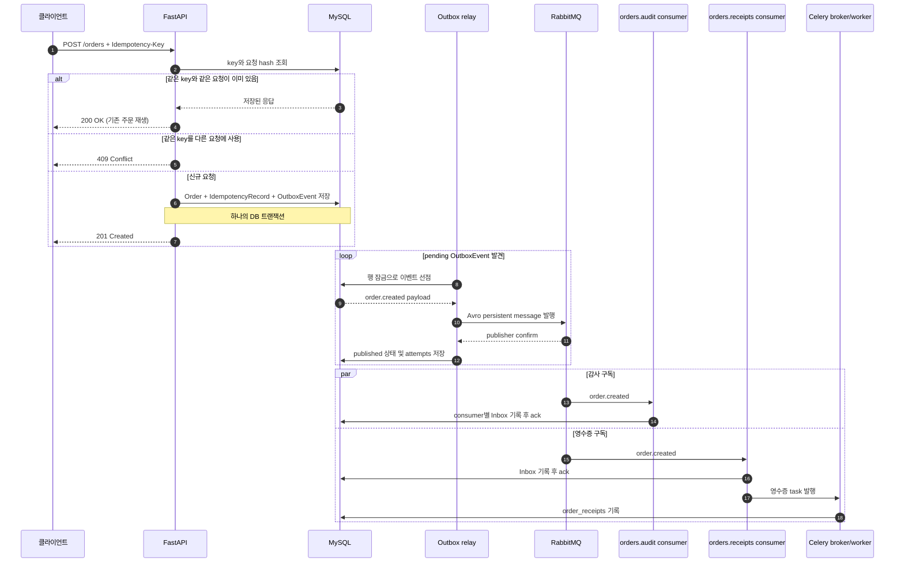
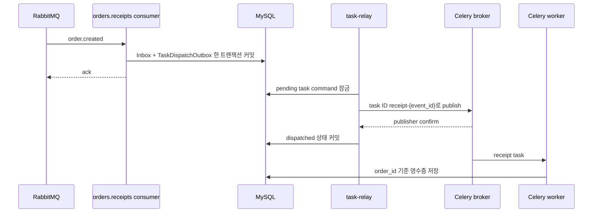

# Order Flow 학습 노트

이 문서는 `apps/order-flow`의 코드를 읽고 실행하면서 메시지 처리의 경계와 보장을 복습하기 위한 워크북이다. 코드를 실행하는 것만으로 학습 체크를 완료하지 않는다. 각 항목을 직접 확인하거나 자기 말로 설명한 뒤 체크한다.

## 학습 경로

- [ ] 현재 흐름을 아래 그림 없이 말로 설명한다.
- [ ] 주문 요청의 멱등성 재시도와 충돌을 직접 확인한다.
- [ ] MySQL에서 주문부터 영수증까지 한 건을 연결해 본다.
- [ ] Outbox relay의 중복 발행 가능성과 consumer Inbox의 역할을 설명한다.
- [ ] Inbox commit과 Celery 제출 사이의 유실 가능성을 설명한다.
- [ ] Task Outbox를 추가해 Inbox와 작업 발행 의도를 원자적으로 기록한다.
- [ ] task relay의 재발행 가능성과 업무 효과 멱등성의 차이를 설명한다.
- [ ] 주문 상태 API에서 단계별 처리 현황을 읽고 로그를 ID로 연결한다.

## 단계별 기록

구현 커밋은 작게 나뉘어 있다. 각 변경을 읽은 뒤 아래 복습 항목을 직접 설명하면 해당 학습 체크박스를 표시한다.

| 단계 | 커밋 | 변경 |
|---|---|---|
| 0 | `ab1aa79` | 현재 주문 이벤트 흐름 복습 자료 |
| 1 | `85e737c` | Task Outbox와 Celery task relay |
| 2 | `78658a4` | 주문 처리 상태 조회와 ID 상관 로그 |
| 3 | `abe9112` | 제한된 consumer 재시도와 DLQ |
| 4 | `0e0533c` | Avro writer 버전 표시와 호환성 테스트 |

## 1. 기준 구현(커밋 `ab1aa79`) 복습 흐름

아래는 Task Outbox 적용 전 기준 흐름이다. 다음 절에서 현재 구현과 달라진 task 전달 부분을 비교한다.



API 응답은 주문이 DB에 접수됐다는 뜻이다. 응답 시점에 RabbitMQ 발행이나 영수증 처리가 끝났다는 뜻은 아니다. 후속 처리는 별도 컨테이너가 비동기로 수행한다.

## 2. 프로세스와 테이블의 책임

| 구성요소 | 책임 | 핵심 코드 |
|---|---|---|
| API | 요청 검증, 멱등성 검사, 세 DB 레코드 원자 저장 | `src/order_flow/api.py` |
| Outbox relay | pending 이벤트를 Avro로 인코딩해 RabbitMQ에 발행 | `src/order_flow/relay.py`, `src/order_flow/events.py` |
| RabbitMQ | 하나의 도메인 이벤트를 독립 구독 큐에 fan-out | `orders.events` exchange |
| audit consumer | 감사 구독의 이벤트 처리 여부를 기록 | `src/order_flow/consumer.py` |
| receipts consumer | 영수증 구독의 Inbox와 Celery task 발행 의도를 기록 | `src/order_flow/dispatch.py` |
| Celery worker | 주문별 영수증 효과를 한 번만 DB에 기록 | `src/order_flow/tasks.py`, `src/order_flow/receipts.py` |
| Task Outbox relay (1단계에서 추가) | pending task command를 결정적 task ID로 Celery에 발행 | `src/order_flow/task_relay.py` |

| 테이블 | 저장 내용 | 중복 방지 기준 |
|---|---|---|
| `orders` | 접수한 주문 | `id` |
| `idempotency_records` | HTTP 요청 키, 본문 hash, 재생할 응답 | `key` |
| `outbox_events` | 발행할 `order.created` 이벤트, 발행 상태와 시도 횟수 | 이벤트 `id` |
| `processed_messages` | 각 RabbitMQ 구독자가 처리한 이벤트 | `(consumer_name, message_id)` |
| `task_dispatch_outbox` (1단계에서 추가) | Celery에 전달할 영수증 명령과 전달 상태 | 원본 이벤트 ID |
| `order_receipts` | 영수증 처리 결과 | `order_id` |

여기서 멱등성은 한 가지 키로 전체 시스템을 덮는 기능이 아니다. HTTP 재시도는 `Idempotency-Key`, consumer 재전달은 consumer 이름과 메시지 ID, Celery 재실행은 주문 ID로 각각 막는다.

## 3. 요청 멱등성 직접 확인

루트 디렉터리에서 별도 스택을 실행한다.

```sh
docker compose -f apps/order-flow/compose.yaml up --build -d
```

Swagger의 `POST /orders`에서 아래 본문과 `Idempotency-Key: study-001` 헤더로 요청한다.

```json
{"sku":"book-1","quantity":1}
```

같은 키와 같은 본문을 다시 보내면 같은 주문 ID와 본문으로 `200` 응답을 받는다. 같은 키에 `quantity: 2`처럼 다른 본문을 보내면 `409`를 받는다. 키가 다른 새로운 주문을 만들 때는 다른 값을 사용한다.

## 4. DB에서 한 주문 추적하기

MySQL에 접속한다.

```sh
docker compose -f apps/order-flow/compose.yaml exec mysql mysql -uorder_flow -porder_flow order_flow
```

최근 데이터를 먼저 살펴본다.

```sql
SELECT * FROM orders ORDER BY created_at DESC LIMIT 10;
SELECT * FROM idempotency_records ORDER BY created_at DESC LIMIT 10;
SELECT * FROM outbox_events ORDER BY created_at DESC LIMIT 10;
SELECT * FROM processed_messages ORDER BY processed_at DESC LIMIT 10;
SELECT * FROM order_receipts ORDER BY sent_at DESC LIMIT 10;
```

주문 응답의 ID를 넣어 이벤트와 구독 처리, 영수증을 함께 확인한다.

```sql
SELECT o.id AS order_id, o.sku, o.quantity,
       e.id AS event_id, e.status AS outbox_status, e.attempts,
       p.consumer_name, r.sent_at AS receipt_recorded_at
FROM orders AS o
JOIN outbox_events AS e ON e.aggregate_id = o.id
LEFT JOIN processed_messages AS p ON p.message_id = e.id
LEFT JOIN order_receipts AS r ON r.order_id = o.id
WHERE o.id = 'ORDER_ID_HERE';
```

최종 처리 뒤에는 `published`, 두 consumer 이름(`orders.audit`, `orders.receipts`), 영수증 시각을 확인한다. 처리 직후가 아니면 중간 상태도 관찰할 수 있다. 두 consumer 행은 같은 이벤트를 구독한 두 처리자 기록이며 주문이 두 건이라는 뜻이 아니다.

## 5. 현재 코드의 전달 보장과 장애 구간

### Outbox relay

Relay는 `pending` 행을 `FOR UPDATE SKIP LOCKED`로 잠그고 메시지를 persistent로 발행한다. publisher confirm을 받은 뒤 Outbox 상태를 `published`로 바꾼다. RabbitMQ가 수락한 직후 DB 상태 커밋 전에 프로세스가 종료되면, 재시작 후 같은 이벤트를 다시 발행할 수 있다. 이는 중복 발행이며, 각 consumer의 Inbox 고유 키가 중복 효과를 억제한다.

### RabbitMQ consumer

각 큐는 독립 구독이다. 처리 성공 후 메시지를 ack한다. 실패하면 기본 최대 3회 재시도(최초 처리를 포함해 최대 4회, 환경변수 `CONSUMER_MAX_RETRIES`)까지 queue별 retry 큐로 보내고 3초(`CONSUMER_RETRY_DELAY_MS`) 뒤 해당 consumer 큐로 돌아오게 한다. 재시도 publish가 confirm되면 원본을 ack한다. 허용 횟수를 소진하면 `orders.audit.dlq` 또는 `orders.receipts.dlq`에 보존한다. 이 정책은 일시 오류와 스키마 오류를 구분하지 않고 모두 재시도한 뒤 DLQ로 보낸다.

### Inbox와 Celery 사이

기준 구현에서는 consumer의 `record_and_dispatch`가 Inbox 트랜잭션 뒤에 `send_order_receipt.delay(...)`를 호출했다. Inbox 커밋과 Celery 제출은 원자적이지 않아 중간 종료 시 영수증 task가 누락될 수 있었다. 1단계에서 이 구간을 Task Outbox로 보완했다.

현재 `record_and_enqueue`는 `orders.receipts`용 Inbox 행과 `task_dispatch_outbox` 명령을 같은 DB 트랜잭션에서 저장한다. 별도 `task-relay` 프로세스는 pending 명령을 잠그고 `receipt-{이벤트ID}` 형식의 결정적 task ID로 publisher confirm을 켠 Celery broker에 제출한 뒤 `dispatched` 상태로 바꾼다. 제출이 실패하면 행은 pending으로 남고, 시도 횟수는 기록되어 다음 poll에서 재시도된다.

### Celery 작업

작업은 late ack와 예외 재시도를 설정한다. worker가 작업을 반복 수행해도 `order_receipts.order_id` 기본 키로 영수증 효과는 한 건만 남는다. 이것은 업무 효과의 멱등성이지 broker에 task가 한 번만 전달된다는 보장은 아니다. task relay가 broker 발행 확인을 받았어도 DB 상태 변경 전에 종료되면 같은 task ID로 재제출할 수 있다. Celery는 task ID만으로 중복 실행을 제거하지 않으므로 worker의 DB 멱등성이 계속 필요하다.

## 6. Task Outbox 단계 확인하기

Task Outbox는 domain event Outbox와 목적이 다르다. `outbox_events`는 주문 트랜잭션에서 RabbitMQ domain event 발행을 예약한다. `task_dispatch_outbox`는 receipt consumer가 처리한 event에 대응하는 Celery command 발행을 예약한다.



```sql
SELECT id, order_id, status, attempts, created_at, dispatched_at
FROM task_dispatch_outbox
ORDER BY created_at DESC
LIMIT 10;
```

정상 완료된 명령은 `dispatched`이며, `attempts`는 relay가 시도한 횟수다. `task-relay`와 `celery-worker` 로그를 함께 보며 같은 order ID와 결정적 task ID를 확인한다.

- [ ] Inbox와 task command가 한 트랜잭션인 이유를 설명한다.
- [ ] RabbitMQ confirm 뒤 task relay가 죽으면 어떤 중복이 생기는지 설명한다.
- [ ] 결정적 task ID와 receipt 테이블의 `order_id` 고유 키가 각각 무엇을 보장하는지 구분한다.

## 7. 복습 질문

각 항목을 코드 위치를 들어 설명해 본다.

1. API가 주문, 멱등성 응답, Outbox 이벤트를 한 트랜잭션에 저장하는 이유는 무엇인가?
2. API가 `201`을 반환한 직후 아직 완료되지 않았을 수 있는 작업은 무엇인가?
3. Relay가 같은 이벤트를 다시 발행할 수 있는 장애 순서는 무엇이며, 어느 키가 중복 효과를 막는가?
4. `orders.audit`와 `orders.receipts`가 각각 Inbox 레코드를 가져야 하는 이유는 무엇인가?
5. 현재 구현에서 Inbox가 있는데도 영수증 task가 사라질 수 있는 시간 구간은 어디인가?
6. Celery task가 두 번 수행될 때 `order_receipts`에 한 행만 남는 이유는 무엇인가?
7. 이 시스템에서 “exactly once”라고 말할 수 없는 이유는 무엇인가?

## 8. 주문 상태와 로그 추적

`GET /orders/{order_id}`는 새 상태를 따로 저장하지 않는다. `orders`, `outbox_events`, `processed_messages`, `task_dispatch_outbox`, `order_receipts`를 읽어 현재 시점의 진행 정보를 조합한다. 따라서 응답은 비동기 처리 흐름의 스냅샷이며 조회 직후 다음 단계로 바뀔 수 있다.

```sh
curl http://localhost:17777/orders/ORDER_ID_HERE
```

응답에서 `event_status`, `processed_consumers`, `receipt_task_status`, `receipt_recorded`를 보고 아직 멈춰 있는 경계를 찾는다. 존재하지 않는 주문 ID는 `404`다.

로그도 같은 주문 ID를 기준으로 따라간다.

```sh
docker compose -f apps/order-flow/compose.yaml logs -f outbox-relay consumer task-relay celery-worker
```

Relay 로그는 `order_id`와 `event_id`, consumer 로그는 `order_id`와 `message_id`, task relay와 worker 로그는 `order_id`와 `task_id`를 남긴다. 이벤트 ID는 consumer와 task 사이에서 같은 이벤트를 식별한다. Celery task ID는 `receipt-{event_id}` 형식이다.

- [ ] 주문 ID 하나로 API 상태 응답과 각 프로세스 로그를 연결한다.
- [ ] task 상태가 `dispatched`여도 receipt 행이 아직 없을 수 있는 이유를 설명한다.
- [ ] 상태 조회 응답이 강한 일관성의 단일 상태 열이 아니라 여러 저장 지점을 합친 snapshot임을 설명한다.

## 9. Avro 스키마 진화

현재 v2는 기존 필드를 그대로 두고 nullable `customer_note`를 `default: null`과 함께 추가한다. 호환성은 writer schema와 reader schema를 둘 다 알아야 판단할 수 있다.

| Writer | Reader | 결과 | 이유 |
|---|---|---|---|
| v1 | v2 | 호환 | 새 reader가 v1 메시지에 없는 `customer_note`를 기본값 `null`로 채움 |
| v2 | v1 | 호환 | 구 reader가 모르는 추가 필드 `customer_note`를 무시함 |
| v1 `quantity: int` | reader `quantity: string` | 비호환 | 기존 필드 타입을 바꿈 |
| v1 | 새 필수 필드에 default가 없는 reader | 비호환 | 과거 메시지에는 새 필드 값이 없음 |

테스트는 `encode_order_created(..., writer_version=1|2)`와 `decode_order_created(..., writer_version=..., reader_version=...)`로 두 스키마를 명시해 resolution을 검증한다. 현재 relay는 기본 v1을 쓰지만 RabbitMQ 메시지 header에 `schema-version`을 붙이고, consumer는 그 값을 writer schema 선택에 사용한다. header가 없는 기존 메시지는 v1으로 읽는다. Compose의 `ORDER_CREATED_SCHEMA_VERSION=2`를 지정하면 relay가 v2 writer로 동작한다.

실습 순서:

1. 기본 v1 relay로 주문을 생성하고 이벤트 메시지의 `schema-version=1`을 확인한다.
2. consumer가 v2 reader를 사용하고 있는지 `decode_order_created_v2` 테스트를 확인한다.
3. Compose 환경변수 `ORDER_CREATED_SCHEMA_VERSION=2`로 relay만 재시작하고 주문을 생성한다.
4. `customer_note`가 없으면 writer 기본값 `null`로 기록되고 consumer가 v2 writer를 읽는 것을 확인한다.
5. 테스트에서 `quantity` 타입 변경이나 default 없는 필드 추가가 실패하는 이유를 설명한다.

- [ ] v1 writer → v2 reader 및 v2 writer → v1 reader가 각각 무엇을 의미하는지 설명한다.
- [ ] 기존 필드를 삭제하거나 타입을 바꾸는 작업이 위험한 이유를 설명한다.
- [ ] 메시지 header의 writer schema 버전과 consumer의 reader schema 버전을 구분한다.

## 다음 단계 미리보기

다음은 RabbitMQ에서 실제 DLQ 재생을 실행하고, 각 보장 범위를 직접 설명하는 최종 복습이다.
