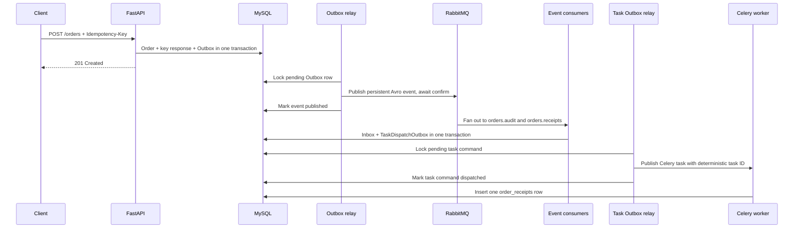

# Order Flow Lab

Order Flow is an isolated learning app for async FastAPI and SQLAlchemy, transactional Outbox publishing, Avro, RabbitMQ consumers, Celery tasks, and idempotency. It has its own Compose stack, ports, and MySQL volume; it does not reuse the root app stack.

For the step-by-step review, failure scenarios, SQL walkthrough, and learner checklist, see [LEARNING_GUIDE.md](LEARNING_GUIDE.md).

## Start and stop

From the repository root:

```sh
docker compose -f apps/order-flow/compose.yaml up --build -d
```

Or run `docker compose up --build -d` from this directory. Open the API docs at <http://localhost:17777/docs> and RabbitMQ management at <http://localhost:15673>. RabbitMQ login is `order_flow` / `order_flow`. MySQL is available on `localhost:13307` with database, user, and password `order_flow`.

Stop the containers while keeping database and broker data:

```sh
docker compose -f apps/order-flow/compose.yaml down
```

Reset the lab data as well:

```sh
docker compose -f apps/order-flow/compose.yaml down -v
```

## Order processing flow



The event queues represent separate subscribers to the same fact. Only `orders.receipts` records a task command in `task_dispatch_outbox`; the separate task relay submits it to Celery. RabbitMQ's `orders.events` exchange handles domain events; Celery uses the `order.tasks` queue for work commands. Consumer failures retry through a queue-specific delay queue (up to 3 retries, 3 seconds by default) and then move to that consumer's durable DLQ. Avro writer versions are carried in the AMQP `schema-version` header; the relay writes v1 by default and can be switched to v2 with `ORDER_CREATED_SCHEMA_VERSION=2`.

## Create an order

In Swagger, expand `POST /orders`, select **Try it out**, set the required `Idempotency-Key` header (for example, `checkout-001`), and enter this JSON body:

```json
{
  "sku": "book-1",
  "quantity": 1
}
```

There are no query parameters. `sku` must be 1–100 characters and `quantity` must be an integer from 1 to 10000. The header is separate from the JSON body. Invalid JSON or a missing header returns `422`.

The first request returns `201` with an order ID. Retrying the same logical request with the same key and body returns `200` with the same response; it does not add the quantities together. Reusing that key with a different body returns `409`. Use a different key for each separate order.

The same request can be sent from a terminal:

```sh
curl -i http://localhost:17777/orders \
  -H 'Content-Type: application/json' \
  -H 'Idempotency-Key: checkout-001' \
  -d '{"sku":"book-1","quantity":1}'
```

Check asynchronous progress by using the order ID returned above:

```sh
curl -i http://localhost:17777/orders/ORDER_ID_HERE
```

The response reports the order status, Outbox event status, consumer names recorded in the Inbox, task-dispatch status, and whether a receipt row exists. It is a snapshot assembled from current DB rows; polling may show progress between those stages.

## Inspect the results

In RabbitMQ management, open **Exchanges** and inspect `orders.events` and its bindings to `orders.audit` and `orders.receipts`. Under **Queues and Streams**, both queues should have a consumer. Message count may already be zero because the consumers acknowledge messages promptly. The Celery worker listens on `order.tasks`; its output is available with:

```sh
docker compose -f apps/order-flow/compose.yaml logs -f celery-worker
```

Inspect task publication attempts with:

```sh
docker compose -f apps/order-flow/compose.yaml logs -f task-relay
```

RabbitMQ also has `orders.audit.retry`, `orders.receipts.retry`, `orders.audit.dlq`, and `orders.receipts.dlq`. To exercise failure handling, stop the relevant consumer, publish an invalid Avro message to `orders.events` with routing key `order.created`, then start the consumer again. Inspect the matching DLQ after the configured retries. A DLQ message can be replayed to `orders.events` with routing key `order.created` after removing its `x-retry-count` and `x-failure-reason` headers; this fans it out to both subscribers, and the subscriber that already processed it will deduplicate through its Inbox record.

To inspect MySQL from a terminal:

```sh
docker compose -f apps/order-flow/compose.yaml exec mysql mysql -uorder_flow -porder_flow order_flow
```

Then run:

```sql
SHOW TABLES;
SELECT * FROM orders ORDER BY created_at DESC LIMIT 10;
SELECT * FROM outbox_events ORDER BY created_at DESC LIMIT 10;
SELECT * FROM processed_messages ORDER BY processed_at DESC LIMIT 10;
SELECT * FROM task_dispatch_outbox ORDER BY created_at DESC LIMIT 10;
SELECT * FROM order_receipts ORDER BY sent_at DESC LIMIT 10;
```

To trace one order, replace the ID with the value returned by the API:

```sql
SELECT o.id AS order_id, o.sku, o.quantity,
       e.id AS event_id, e.status AS outbox_status,
       p.consumer_name, t.status AS task_status, t.attempts AS task_attempts,
       r.sent_at AS receipt_recorded_at
FROM orders AS o
JOIN outbox_events AS e ON e.aggregate_id = o.id
LEFT JOIN processed_messages AS p ON p.message_id = e.id
LEFT JOIN task_dispatch_outbox AS t ON t.id = e.id
LEFT JOIN order_receipts AS r ON r.order_id = o.id
WHERE o.id = 'YOUR_ORDER_ID';
```

Expect `outbox_status = published`, one row for each consumer (`orders.audit` and `orders.receipts`), `task_status = dispatched`, and a non-null receipt timestamp. The two consumer rows describe two independent subscribers processing one event; they do not represent two orders.

## Delivery guarantees to examine

The relay publishes while holding the Outbox row lock. If RabbitMQ confirms a message but the relay exits before MySQL commits the `published` status, it may publish the event again after restart. The consumers deduplicate by `(consumer_name, message_id)`.

The receipts consumer commits its Inbox record and task-dispatch Outbox command in one MySQL transaction. The task relay publishes pending commands and marks them dispatched after Celery's publisher confirm. If the broker accepts a task but the relay loses the confirmation or exits before the DB update, it can submit that task again with the same deterministic task ID. Celery does not deduplicate tasks by ID, so the receipt effect remains protected by the `order_id` primary key. This is at-least-once delivery, not exactly-once execution. The task uses late acknowledgment and retries failures with backoff.

Consumer failures retry through durable per-queue delay queues and are routed to per-consumer DLQs after the configured limit. The consumer publisher uses RabbitMQ publisher confirms before acknowledging the failed original message. Replay from a DLQ should reset `x-retry-count`; otherwise the next failure returns directly to the DLQ. Replay to `order.created` fans out to both consumers, whose Inbox keys suppress duplicate effects.

## Tests

From this directory, install test dependencies and run the unit suite:

```sh
python -m pip install -e '.[test]'
pytest -q
```

The tests use in-memory SQLite for transaction and idempotency behavior. Compose provides the MySQL/RabbitMQ end-to-end environment. The API runs `alembic upgrade head` before starting.
